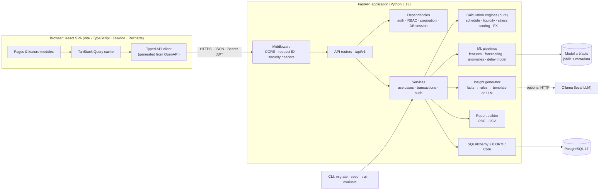
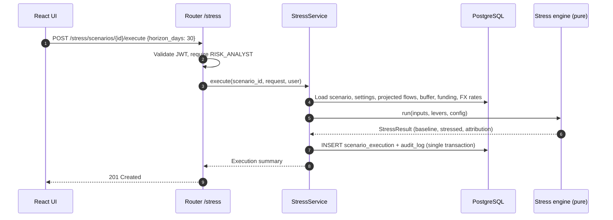
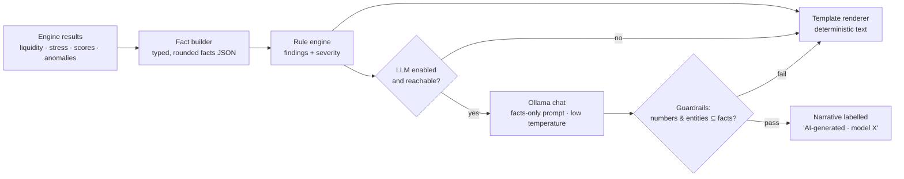

# Technical Plan: AI-Powered Financial Risk & Liquidity Simulator

> **Status:** Phase 1 draft, awaiting review · **Date:** 2026-11-08
> **Data notice:** Every dataset in this project is **synthetic**. No proprietary banking data, paid APIs, or cloud services are used.
> **Regulatory notice:** All metrics are simulation metrics. None of them is a regulatory ratio (LCR, NSFR, ALMM, etc.), even where the structure is similar.

## Contents

0. [Summary, environment findings, decisions, ambiguities](#0-summary)
1. [System architecture](#1-system-architecture)
2. [Project directory structure](#2-project-directory-structure)
3. [Database design and ER diagram](#3-database-design)
4. [API specification](#4-api-specification)
5. [Financial calculation methodology](#5-financial-calculation-methodology)
6. [ML and AI strategy (including synthetic data design)](#6-ml-and-ai-strategy)
7. [Development roadmap and milestones](#7-development-roadmap)
8. [Technical challenges and solutions](#8-technical-challenges-and-solutions)
9. [Open questions for review](#9-open-questions-for-review)

---

## 0. Summary

The platform is a monorepo with a **FastAPI backend** (layered as routers, then services, then *pure calculation engines*), a **PostgreSQL** database, a **React/Vite SPA**, an **ML package** of classical statistics plus gradient boosting with honest backtesting, and an **optional local LLM (Ollama)**. The LLM only rewrites findings that the deterministic engines have already computed, and a guardrail rejects any narrative containing numbers that are not in the computed facts.

Design principles:

1. **Calculations are deterministic, pure and testable.** Engines take immutable inputs and return results. They never touch the database, the clock or randomness.
2. **Money is `Decimal` end to end**: `NUMERIC` in PostgreSQL, `Decimal` in Python, strings in JSON. Floats appear only inside ML models and chart rendering.
3. **Derived values are computed, not stored**: overdue status, base-currency equivalents and cash history. The exception is stress executions, which are persisted as immutable snapshots for reproducibility.
4. **Every result is traceable**: stress executions store a parameter snapshot, an input fingerprint and the engine version, and ML runs store data fingerprints and metrics produced by code.
5. **The app runs without the LLM.** Every AI narrative has a deterministic template fallback.

### 0.1 Environment findings (this machine)

| Item | Found | Impact on plan |
|---|---|---|
| OS | Windows 10 Pro **1809** (build 17763), WSL1 only | **Docker Desktop cannot run here.** It needs Windows 10 22H2+ and WSL2/Hyper-V support that 1809 lacks. |
| Python | 3.14.1 | Usable. Recommend pinning **3.13 via `uv`** for parity with Docker/CI images (see Q2). |
| Node / npm | 22.19 / 10.9 | Meets current Vite requirements. |
| PostgreSQL | Not installed | Install PostgreSQL 17 (Windows installer) for local development. |
| Docker | Not installed | See above. |
| Ollama | Not installed | Ollama's Windows build also targets Windows 10 22H2+, so expect it not to run here. The LLM is optional; `OLLAMA_BASE_URL` can point at another machine. |
| Git | 2.56 | Workspace is not yet a repository. |

**Consequence:** development is **native-first** (local PostgreSQL, `uvicorn`, Vite dev server). The Docker Compose stack is still a deliverable: images are built and a compose smoke test runs in **GitHub Actions** on every push, so containerisation is verified even though it can't run locally.

### 0.2 Key architectural decisions

| # | Decision | Choice | Rationale | Rejected alternative |
|---|---|---|---|---|
| D1 | Repository layout | Monorepo: `backend/`, `frontend/`, `docs/` | One CI pipeline, atomic API and UI changes, simpler review | Separate repositories |
| D2 | DB access style | **Sync** SQLAlchemy 2.0 + psycopg 3 | Workload is CPU-bound (calculations, pandas). FastAPI runs sync endpoints in a threadpool. Simpler tests and Alembic. | Async SQLAlchemy: little gain here, more complexity |
| D3 | Layering | Routers → Services → Engines (pure). **No repository layer.** | The SQLAlchemy `Session` already is a unit of work. A repository per entity would be pass-through boilerplate. | Repository/DAO per entity |
| D4 | Money | `NUMERIC(20,4)` storage, `Decimal` engines, JSON strings, quantise to currency minor units at boundaries | Exact arithmetic, and supports 0-, 2- and 3-decimal currencies | `float` or integer minor units |
| D5 | Enums | `VARCHAR` + `CHECK` (SQLAlchemy `Enum(native_enum=False)`) | Native PG enums are painful to alter in migrations | PostgreSQL native `ENUM` |
| D6 | Primary keys | UUID for business entities, `BIGINT IDENTITY` for append-only high-volume tables (audit, forecast points, FX rates) | Non-enumerable public IDs where exposed, compact keys where volume is high | UUID everywhere or bigint everywhere |
| D7 | Scenario parameters | `JSONB` validated by **Pydantic discriminated models** | Scenarios are flexible sets of levers. Typed validation in the app keeps it safe. | EAV parameter tables (worse in every way) |
| D8 | Background work | No task queue. Stress runs are synchronous (sub-second at this data size). ML training runs from the CLI or FastAPI `BackgroundTasks`, with status in `model_runs`. | No Redis/Celery to operate for second-scale jobs | Celery + Redis |
| D9 | Auth | Short-lived JWT access token (memory) + rotating refresh token (httpOnly, SameSite=Strict cookie, hashed in DB). **PyJWT**, **pwdlib[argon2]** | Not exposed to XSS via localStorage, revocable sessions, maintained libraries (passlib is unmaintained) | Tokens in localStorage, python-jose, passlib |
| D10 | API contract | OpenAPI → `openapi-typescript` generated TS types. CI fails on drift. | Front and back cannot silently diverge | Hand-written TS types |
| D11 | PDF generation | **ReportLab** + matplotlib (Agg) charts | Pure Python, works on Windows and in slim containers | WeasyPrint (needs GTK/Pango system libs) |
| D12 | LLM | Optional Ollama over HTTP. Facts-only prompts, numeric/entity guardrails, template fallback. | Practical AI without letting the LLM compute or invent numbers | Hosted LLM APIs (paid), or LLM-computed metrics |
| D13 | ML stack | Seasonal-naive/ETS baselines, Ridge, XGBoost, Isolation Forest/LOF. **No PyTorch, no Sentence Transformers in core.** | Tabular, modest-size data where gradient boosting and classical methods are appropriate. Neural nets would add about 2 GB of image size with no justified gain. | LSTM/Transformer forecasting |
| D14 | Tooling | `uv` (deps + Python version), `ruff`, `mypy` (strict on engines), `pytest` + `hypothesis` | Fast, reproducible, property-based tests suit financial invariants | pip/poetry, flake8/black |
| D15 | Dev environment | Native-first. Docker verified in CI. | Machine constraint (§0.1) | Docker-only workflow |

### 0.3 Requirement ambiguities and proposed resolutions

| # | Ambiguity | Proposed resolution |
|---|---|---|
| A1 | "Total Available Liquidity" has no defined source data | Define it as **cash + haircut-adjusted unencumbered securities (+ optional committed facility headroom)**. This needs two tables the spec doesn't list: `liquid_assets` (securities buffer) and `cash_accounts` (opening cash balance anchor). |
| A2 | Currency Exposures stores *exchange rate* and *base equivalent*, which are derived values | The table stores only positions not captured elsewhere (FX spot/forwards, off-balance items). Rate and base equivalent are **computed at read time** from `fx_rates`. A separate *exposure summary* aggregates all sources (deals, cash, securities, funding, manual positions). |
| A3 | Funding Sources: "available" vs "utilized" means different things for deposits and credit lines | Credit lines: available = limit, utilized = drawn, headroom = difference. Deposit pools: available = utilized = balance (no headroom). Constraint: `0 ≤ utilized ≤ available`. |
| A4 | Overlap between MM deals and funding sources (double counting) | **Rule:** MM deals are bilateral wholesale instruments that generate cash flows. Funding sources are deposit pools and facilities. The same funding is never recorded in both, and the seed data respects this. |
| A5 | Counterparty "risk classification" vs the ML risk score | Keep `risk_classification` as the **analyst-assigned** field. The model writes `risk_assessments`. The UI shows both and flags disagreement. |
| A6 | What "baseline" means for stress comparison | **Baseline = contractual flows + going-concern rollover of maturing funding** (explicit, editable). The Liquidity Analysis module shows the pure contractual view (no rollover), which is the most conservative lens. See §5.13. |
| A7 | "Liquidity Coverage Indicators" could be read as the Basel LCR | Named **Simulated Liquidity Coverage Indicator (SLCI)**, documented as non-regulatory (§5.9). |
| A8 | Synthetic data is time-relative, so "today" drifts as the calendar moves | A **simulation business date** in `app_settings` defaults to the seed's reference date. All "as-of" logic uses it, never the wall clock. |
| A9 | Source of "historical liquidity trends" | Derived: cash opening balance anchor + settled cash flows (SQL window sum). No snapshot table to drift out of sync. |
| A10 | "Amount" on a cash flow is ambiguous for projected vs actual | `amount` (expected) plus `settled_amount` and `actual_date` (set on settlement). |
| A11 | CSV export of a multi-section report | ZIP bundle with one CSV per section. Every list screen also gets a filtered CSV export. |
| A12 | "Deal type" mixes instrument and direction | `deal_type` (instrument) + `direction` (LEND/BORROW). |
| A13 | KPI "High-risk counterparties" | Latest model assessment in band HIGH or CRITICAL. Falls back to the manual classification when no assessment exists. |
| A14 | Point-in-time correctness for ML (ratings change over time) | Add `counterparty_rating_history` so features use the rating *as it was* at each date. |

### 0.4 Deliberate deviations from the specified phase order

- **Synthetic data generator moves into Phase 2.** The frontend and engines need realistic data from the first day of development.
- **CI starts in Phase 2** (lint and tests) and is extended in Phase 7 (Docker build and compose smoke test).
- **The deal cash-flow schedule generator (interest and day count) is built in Phase 2**, because deal CRUD needs it. It is engine code and is tested as such.
- **The Phase 3 dashboard uses simple SQL aggregates.** It switches to engine-backed KPIs (coverage indicator, survival horizon) in Phase 4.

---

## 1. System architecture

### 1.1 Component view



### 1.2 Layer responsibilities

| Layer | Owns | Must not |
|---|---|---|
| **Routers** (`api/v1`) | HTTP concerns: parsing, status codes, response models, role guards | Contain business logic or SQL |
| **Services** (`services/`) | Use cases: load inputs from DB, call engines, persist results, write audit entries, manage transactions | Contain financial formulas |
| **Engines** (`engines/`) | Financial calculations over immutable dataclasses with `Decimal` | Import SQLAlchemy, read the clock, use randomness, do I/O |
| **ML** (`ml/`) | Feature building, training, backtesting, inference, artifact registry | Be imported by engines (one-way dependency) |
| **Insights** (`insights/`) | Fact extraction, rule findings, templates, LLM client, guardrails | Compute financial metrics (it only formats engine output) |
| **Models / Schemas** | ORM tables / Pydantic request-response contracts | Leak ORM objects to responses |

### 1.3 Request lifecycle example: executing a stress scenario



### 1.4 Cross-cutting concerns

- **Configuration:** `pydantic-settings` reads environment variables and `.env`. `.env.example` is committed and `.env` is git-ignored. The app refuses to start in `production` mode with a default `JWT_SECRET`.
- **Errors:** a domain exception hierarchy (`NotFound`, `Conflict`, `ValidationFailed`, `PermissionDenied`, `CalculationError`) is mapped centrally to **RFC 9457 `application/problem+json`** responses that carry the `request_id`. Unexpected exceptions are logged with a stack trace, and the client gets a generic 500.
- **Logging:** structured JSON logs with a per-request `request_id` (also returned as the `X-Request-ID` header).
- **Audit:** services write audit entries **in the same transaction** as the change they record, using an explicit helper rather than ORM event magic.
- **Security:** see §4.2 (RBAC) and §8.

### 1.5 Frontend architecture and design system

**Libraries beyond the specified stack** (all MIT and justified):

| Library | Why |
|---|---|
| `react-router` | Routing |
| `@tanstack/react-query` | Server-state cache, retries, loading and error states |
| `@tanstack/react-table` | Headless tables with server-side sorting and pagination |
| `react-hook-form` + `zod` | Performant forms with schema validation that mirrors the backend rules |
| `openapi-typescript` + `openapi-fetch` | Generated types and a typed fetch client |
| `date-fns` | Date arithmetic and formatting |
| `@fontsource-variable/inter`, `@fontsource/ibm-plex-mono` | Self-hosted fonts, no external CDN |

**Information architecture:**

```
Overview        Dashboard
Analysis        Liquidity Position · Gaps & Maturity Ladder · Concentration & FX
Stress Testing  Scenarios · Executions & Comparison
Intelligence    Forecasts · Anomalies · Counterparty Risk · Insights · Model Performance
Data            Counterparties · MM Deals · Cash Flows · Funding Sources · Liquid Assets
                Cash Accounts · Currency Exposures · FX Rates
Reports         Risk report builder & exports
Admin           Users · Audit Log · Settings (business date, buffer threshold)
```

A persistent top bar shows the **simulation business date**, the **base currency**, a **"SYNTHETIC DATA" badge**, and the user menu.

**Visual system (dark-first):**

- Design tokens live as CSS variables in Tailwind v4's `@theme`. Neutral slate surfaces in three elevation steps, one restrained accent (muted blue), and semantic colours (positive, negative, warning) used **only for meaning**, never decoration. No gradients except an optional subtle one on the login screen.
- **Numbers:** `tabular-nums` and right-aligned in tables. Negative values carry a minus sign and the negative colour, so colour is never the only cue. KPIs use compact notation (`1.25bn`) with the exact value in a tooltip. Currency codes are always shown.
- **Charts:** actual series solid, projected series dashed, and a vertical T₀ reference line. Baseline neutral, stressed in warning hue. Each currency keeps one colour on every chart. A donut only for ≤ 7 categories; bars for counterparty rankings.
- **States:** skeletons for loading. Empty states explain what's missing and offer the next action. Error states show the message, a retry button and the `request_id`.
- **Density:** compact cards and tables suited to treasury users. Keyboard-navigable, WCAG AA contrast, and risk bands always carry text labels, not colour alone.

### 1.6 Deployment views

| Mode | Components |
|---|---|
| **Local native (this machine)** | PostgreSQL 17 service · `uvicorn app.main:app --reload` · `npm run dev` (Vite proxies `/api` to the backend, so the SPA and API are same-origin and the refresh cookie works without CORS tricks) |
| **Docker Compose** (CI-verified) | `db` (postgres:17) · `migrate` (one-shot `alembic upgrade head`) · `backend` (uvicorn) · `frontend` (nginx serving the built SPA and proxying `/api`) · `ollama` (only with `--profile llm`) · volumes `pgdata`, `model_artifacts` |

---

## 2. Project directory structure

```
liquidity-risk-simulator/
├── README.md
├── CHECKLIST.md                      # development checklist (living)
├── .env.example
├── docker-compose.yml
├── .github/workflows/ci.yml
├── docs/
│   ├── TECHNICAL_PLAN.md             # this document
│   ├── architecture.md               # diagrams + ADR summary (from §1)
│   ├── database.md                   # ER diagrams, table reference
│   ├── api.md                        # conventions + endpoint guide (OpenAPI is canonical)
│   ├── methodology/
│   │   ├── liquidity.md              # formulas, assumptions, worked examples
│   │   ├── stress-testing.md
│   │   └── machine-learning.md
│   ├── ml-evaluation.md              # GENERATED by `lrs evaluate` (never hand-written)
│   ├── limitations.md
│   └── adr/                          # architecture decision records
├── backend/
│   ├── pyproject.toml · uv.lock · alembic.ini · Dockerfile
│   ├── alembic/versions/
│   ├── app/
│   │   ├── main.py                   # app factory, middleware, router mounting
│   │   ├── cli.py                    # lrs seed | train | evaluate | create-admin
│   │   ├── core/
│   │   │   ├── config.py             # pydantic-settings
│   │   │   ├── security.py           # JWT, password hashing
│   │   │   ├── rbac.py               # roles → permissions
│   │   │   ├── errors.py             # domain exceptions + problem+json handlers
│   │   │   ├── logging.py
│   │   │   ├── money.py              # Decimal context, quantise per currency
│   │   │   └── calendar.py           # business days, modified-following, day count
│   │   ├── db/                       # base, session, mixins (timestamps, version)
│   │   ├── models/                   # ORM: one module per aggregate
│   │   ├── schemas/                  # Pydantic request/response models
│   │   ├── api/
│   │   │   ├── deps.py               # current_user, require_role, pagination, db
│   │   │   └── v1/                   # auth, users, counterparties, deals, cash_flows,
│   │   │                             # funding, liquid_assets, cash_accounts, exposures,
│   │   │                             # fx, dashboard, liquidity, stress, ml, risk,
│   │   │                             # insights, reports, audit, system
│   │   ├── services/                 # use-case orchestration (load → engine → persist)
│   │   ├── engines/                  # PURE: no DB, no clock, no randomness
│   │   │   ├── types.py              # immutable input/output dataclasses
│   │   │   ├── schedule.py           # deal → cash-flow schedule (interest)
│   │   │   ├── liquidity.py          # positions, gaps, ladder, survival, SLCI
│   │   │   ├── concentration.py      # HHI, top-N, funding dependency
│   │   │   ├── fx.py                 # conversion, NOP, cross-currency netting
│   │   │   ├── stress/               # levers/, runner.py, attribution.py, presets.py
│   │   │   └── scoring.py            # counterparty scorecard
│   │   ├── ml/
│   │   │   ├── datasets.py           # point-in-time data extraction
│   │   │   ├── features.py
│   │   │   ├── forecasting/          # baselines.py, linear.py, gbm.py, backtest.py, intervals.py
│   │   │   ├── anomaly/              # robust_z.py, isolation_forest.py, residual.py
│   │   │   ├── delay_model.py        # payment-delay propensity classifier
│   │   │   ├── evaluation.py         # metrics + report generation
│   │   │   └── registry.py           # artifacts + model_runs bookkeeping
│   │   ├── insights/                 # facts.py, rules.py, templates.py, llm.py, guardrails.py
│   │   ├── reports/                  # pdf.py, csv_export.py, charts.py
│   │   └── synthetic/                # generator modules, config, ground-truth labels
│   ├── var/                          # git-ignored runtime data (model artifacts)
│   └── tests/
│       ├── unit/                     # engines, calendar, money, scoring, guardrails, ml
│       ├── property/                 # hypothesis invariants
│       ├── golden/                   # hand-computed worked examples (JSON fixtures)
│       ├── integration/              # API + services against real PostgreSQL
│       └── conftest.py
└── frontend/
    ├── package.json · vite.config.ts · tsconfig.json · Dockerfile · nginx.conf
    └── src/
        ├── main.tsx · App.tsx · routes.tsx
        ├── api/                      # client.ts, schema.d.ts (generated), query keys
        ├── auth/                     # AuthProvider, RequireRole
        ├── components/
        │   ├── ui/                   # Button, Input, Select, DataTable, Badge, Card, Stat,
        │   │                         # Tabs, Dialog, Drawer, Skeleton, EmptyState, ErrorState
        │   ├── charts/               # themed Recharts wrappers (series, stacked, waterfall, donut)
        │   └── layout/               # AppShell, Sidebar, TopBar
        ├── features/                 # dashboard, liquidity, stress, intelligence, reports,
        │                             # counterparties, deals, cash-flows, funding, liquid-assets,
        │                             # cash-accounts, exposures, fx-rates, admin
        ├── lib/                      # format (money, %, dates), decimal helpers
        └── styles/                   # tokens.css (@theme), globals.css
```

---

## 3. Database design

### 3.1 Conventions

- PostgreSQL 17, schema managed only through **Alembic** (autogenerate, then hand-review every migration).
- Money: `NUMERIC(20,4)`. Rates (interest, FX): `NUMERIC(18,8)` for FX and `NUMERIC(12,8)` for interest, stored as a fraction (0.0525 = 5.25%), negative allowed. Ratios and haircuts: `NUMERIC(7,6)`.
- Every mutable table has `created_at` and `updated_at` (`timestamptz`), `created_by` and `updated_by` (FK users, nullable for seed), and `version INT` for **optimistic locking** (SQLAlchemy `version_id_col`).
- Enums: `VARCHAR` + `CHECK` (D5). Countries ISO 3166-1 alpha-2, currencies ISO 4217.
- Synthetic provenance: master-data tables carry `is_synthetic BOOLEAN NOT NULL DEFAULT false`. The seeder sets it to `true` and records a `seed_runs` row.
- Deletion: FKs are `ON DELETE RESTRICT`. Master data is archived with `is_active = false` when referenced. Deals are *cancelled*, never deleted.
- Extensions: `pg_trgm` for fuzzy search on names and references.

### 3.2 ER diagram, part A: core financial domain

```mermaid
erDiagram
    COUNTRIES ||--o{ COUNTERPARTIES : "domicile of"
    COUNTERPARTIES ||--o{ COUNTERPARTY_RATING_HISTORY : "rated over time"
    CURRENCIES ||--o{ FX_RATES : "priced by"
    CURRENCIES ||--o| CASH_ACCOUNTS : "settled in"
    CURRENCIES ||--o{ MONEY_MARKET_DEALS : denominates
    CURRENCIES ||--o{ CASH_FLOWS : denominates
    CURRENCIES ||--o{ FUNDING_SOURCES : denominates
    CURRENCIES ||--o{ LIQUID_ASSETS : denominates
    CURRENCIES ||--o{ CURRENCY_EXPOSURES : denominates
    COUNTERPARTIES ||--o{ MONEY_MARKET_DEALS : "party to"
    COUNTERPARTIES |o--o{ CASH_FLOWS : "pays or receives"
    COUNTERPARTIES |o--o{ FUNDING_SOURCES : provides
    COUNTERPARTIES |o--o{ LIQUID_ASSETS : issues
    COUNTERPARTIES |o--o{ CURRENCY_EXPOSURES : "relates to"
    MONEY_MARKET_DEALS |o--|{ CASH_FLOWS : schedules

    COUNTRIES {
        char code PK "ISO 3166-1 alpha-2"
        varchar name
        smallint risk_tier "1-5, synthetic"
    }
    CURRENCIES {
        char code PK "ISO 4217"
        varchar name
        smallint minor_units "0, 2 or 3"
        varchar day_count "ACT_360 / ACT_365F default"
    }
    FX_RATES {
        bigint id PK
        char currency_code FK
        date rate_date "unique with currency"
        numeric rate_to_base "base units per 1 unit, > 0"
        varchar source "SYNTHETIC / MANUAL"
    }
    COUNTERPARTIES {
        uuid id PK
        varchar name UK
        varchar counterparty_type "BANK / CENTRAL_BANK / SOVEREIGN / CORPORATE / NBFI / FUND"
        char country_code FK
        varchar credit_rating "AAA ... D, current"
        varchar risk_classification "LOW / MEDIUM / HIGH / CRITICAL, manual"
        boolean is_active
        boolean is_synthetic
        int version
    }
    COUNTERPARTY_RATING_HISTORY {
        bigint id PK
        uuid counterparty_id FK
        varchar credit_rating
        date effective_date "unique with counterparty"
    }
    MONEY_MARKET_DEALS {
        uuid id PK
        varchar deal_reference UK
        uuid counterparty_id FK
        char currency_code FK
        varchar deal_type "TERM_DEPOSIT / OVERNIGHT / REPO / CD / CP"
        varchar direction "LEND / BORROW"
        numeric principal "> 0"
        numeric interest_rate "annual fraction"
        varchar day_count "ACT_360 / ACT_365F"
        date deal_date
        date value_date ">= deal_date"
        date maturity_date "> value_date"
        varchar interest_frequency "AT_MATURITY / MONTHLY / QUARTERLY / SEMI_ANNUAL"
        varchar settlement_status "PENDING / SETTLED / MATURED / CANCELLED / FAILED"
        boolean is_synthetic
        int version
    }
    CASH_FLOWS {
        uuid id PK
        varchar transaction_reference UK
        uuid deal_id FK "nullable"
        uuid counterparty_id FK "nullable"
        char currency_code FK
        varchar direction "IN / OUT"
        varchar category "PRINCIPAL / INTEREST / DEPOSIT / CUSTOMER / PAYROLL / TAX / COUPON / FEE / OTHER"
        varchar source "DEAL_SCHEDULE / MANUAL / SYNTHETIC"
        numeric amount "expected, > 0"
        date expected_date
        numeric settled_amount "nullable"
        date actual_date "nullable"
        varchar status "PROJECTED / SETTLED / FAILED / CANCELLED"
        boolean is_synthetic
        int version
    }
    CASH_ACCOUNTS {
        uuid id PK
        char currency_code FK "unique"
        varchar name
        varchar account_type "NOSTRO / CENTRAL_BANK_RESERVE"
        numeric opening_balance
        date opening_date
    }
    FUNDING_SOURCES {
        uuid id PK
        varchar name UK
        varchar funding_type "RETAIL_DEPOSITS / CORPORATE_DEPOSITS / COMMITTED_LINE / UNCOMMITTED_LINE / REPO_FACILITY / CENTRAL_BANK_FACILITY"
        char currency_code FK
        uuid counterparty_id FK "nullable"
        numeric available_amount "limit, or balance for deposits"
        numeric utilized_amount "0 <= utilized <= available"
        date maturity_date "nullable"
        boolean is_synthetic
        int version
    }
    LIQUID_ASSETS {
        uuid id PK
        varchar security_id UK "synthetic ISIN-like"
        varchar name
        varchar asset_class "GOVT_BOND / SUPRANATIONAL / COVERED_BOND / CORPORATE_BOND"
        char currency_code FK
        uuid issuer_counterparty_id FK "nullable"
        numeric market_value ">= 0"
        numeric haircut "0 <= h < 1"
        boolean is_encumbered
        date maturity_date
        boolean is_synthetic
        int version
    }
    CURRENCY_EXPOSURES {
        uuid id PK
        char currency_code FK
        varchar exposure_type "FX_SPOT / FX_FORWARD / OFF_BALANCE_SHEET / OTHER"
        varchar position "LONG / SHORT"
        numeric exposure_amount "> 0, in currency"
        date value_date "nullable"
        uuid counterparty_id FK "nullable"
        varchar description
        boolean is_synthetic
        int version
    }
```



### 3.3 ER diagram, part B: security, scenarios, analytics, audit

```mermaid
erDiagram
    USERS ||--o{ REFRESH_TOKENS : holds
    USERS |o--o{ AUDIT_LOGS : "acts in"
    USERS |o--o{ STRESS_SCENARIOS : authors
    USERS ||--o{ SCENARIO_EXECUTIONS : runs
    USERS |o--o{ MODEL_RUNS : trains
    USERS |o--o{ ANOMALIES : reviews
    STRESS_SCENARIOS ||--o{ SCENARIO_EXECUTIONS : "executed as"
    MODEL_RUNS ||--o{ FORECAST_RESULTS : produces
    MODEL_RUNS ||--o{ ANOMALIES : detects
    MODEL_RUNS |o--o{ RISK_ASSESSMENTS : "contributes to"
    COUNTERPARTIES ||--o{ RISK_ASSESSMENTS : "assessed in"
    CASH_FLOWS |o--o{ ANOMALIES : "flagged as"
    SEED_RUNS ||--o{ SYNTHETIC_LABELS : records
    CASH_FLOWS |o--o{ SYNTHETIC_LABELS : "ground truth for"

    USERS {
        uuid id PK
        varchar email UK "case-insensitive"
        varchar full_name
        varchar password_hash "argon2id"
        varchar role "ADMIN / RISK_ANALYST / VIEWER"
        boolean is_active
        int failed_login_count
        timestamptz locked_until
        timestamptz last_login_at
    }
    REFRESH_TOKENS {
        uuid id PK
        uuid user_id FK
        varchar token_hash UK
        timestamptz expires_at
        timestamptz revoked_at
    }
    STRESS_SCENARIOS {
        uuid id PK
        varchar name UK
        varchar scenario_type "DEPOSIT_WITHDRAWAL / FUNDING_DISRUPTION / COUNTERPARTY_DEFAULT / CURRENCY_SHOCK / MARKET_WIDE / CUSTOM"
        text description
        jsonb parameters "validated lever set"
        boolean is_predefined
        boolean is_active
        uuid created_by FK
        int version
    }
    SCENARIO_EXECUTIONS {
        uuid id PK
        uuid scenario_id FK
        uuid executed_by FK
        timestamptz executed_at
        date as_of_date
        smallint horizon_days
        jsonb parameters_snapshot "immutable copy"
        jsonb engine_config "buffer, facilities flag"
        varchar input_fingerprint "sha256 of inputs"
        varchar engine_version
        numeric baseline_min_liquidity
        numeric stressed_min_liquidity
        numeric funding_requirement
        smallint survival_days "null = beyond horizon"
        date first_breach_date
        jsonb results "series, attribution, impacts"
    }
    MODEL_RUNS {
        uuid id PK
        varchar model_kind "FORECAST / ANOMALY_TXN / ANOMALY_DAILY / DELAY_PROPENSITY"
        varchar algorithm
        varchar status "RUNNING / SUCCEEDED / FAILED"
        jsonb hyperparameters
        jsonb metrics "produced by evaluation code"
        date train_start
        date train_end
        varchar data_fingerprint
        varchar artifact_path
        boolean is_champion
        uuid trained_by FK
        timestamptz started_at
        timestamptz finished_at
    }
    FORECAST_RESULTS {
        bigint id PK
        uuid model_run_id FK
        char currency_code
        varchar target "INFLOW / OUTFLOW"
        date origin_date
        date forecast_date
        numeric p10
        numeric p50
        numeric p90
    }
    ANOMALIES {
        uuid id PK
        uuid model_run_id FK
        varchar level "TRANSACTION / DAILY"
        uuid cash_flow_id FK "nullable"
        char currency_code
        date anomaly_date
        numeric score
        jsonb reasons "top deviating features"
        varchar review_status "NEW / CONFIRMED / DISMISSED"
        uuid reviewed_by FK
        text review_note
    }
    RISK_ASSESSMENTS {
        uuid id PK
        uuid counterparty_id FK
        uuid model_run_id FK "nullable"
        date as_of_date
        numeric score "0-100"
        varchar band "LOW / MODERATE / HIGH / CRITICAL"
        numeric likelihood_score
        numeric impact_score
        jsonb factor_contributions
        varchar scorecard_version
    }
    RISK_INSIGHTS {
        uuid id PK
        varchar context_type "DASHBOARD / SCENARIO_EXECUTION / COUNTERPARTY"
        uuid context_id "nullable, polymorphic"
        jsonb facts
        varchar facts_hash
        text narrative
        varchar generator "TEMPLATE / LLM"
        varchar llm_model "nullable"
        boolean guardrail_passed
        timestamptz created_at
    }
    AUDIT_LOGS {
        bigint id PK
        timestamptz occurred_at
        uuid actor_user_id FK "nullable"
        varchar action "CREATE / UPDATE / DELETE / LOGIN / LOGIN_FAILED / EXECUTE / TRAIN / EXPORT ..."
        varchar entity_type
        varchar entity_id
        jsonb changes "before/after diff"
        varchar request_id
        inet ip_address
    }
    APP_SETTINGS {
        smallint id PK "always 1"
        date business_date
        char base_currency
        numeric min_liquidity_buffer
        boolean include_facilities_default
    }
    SEED_RUNS {
        uuid id PK
        bigint seed
        varchar generator_version
        date reference_date
        jsonb config
        jsonb row_counts
        timestamptz created_at
    }
    SYNTHETIC_LABELS {
        bigint id PK
        uuid seed_run_id FK
        uuid cash_flow_id FK "nullable"
        char currency_code
        date label_date
        varchar anomaly_type
    }
```



> `RISK_INSIGHTS.context_id` is intentionally polymorphic (no FK) because insights attach to different entity types. `SYNTHETIC_LABELS` is read **only** by evaluation code, never by feature pipelines. A test enforces this (§8, C6).

### 3.4 Key constraints and indexes

| Table | Constraints | Indexes |
|---|---|---|
| `money_market_deals` | `principal > 0` · `value_date >= deal_date` · `maturity_date > value_date` · `interest_rate BETWEEN -0.10 AND 1.0` | `UNIQUE(deal_reference)` · `(maturity_date)` · `(counterparty_id)` · `(currency_code, maturity_date)` · trigram on `deal_reference` |
| `cash_flows` | `amount > 0` · `status <> 'SETTLED' OR (actual_date IS NOT NULL AND settled_amount IS NOT NULL)` · `settled_amount >= 0` | Partial `(currency_code, expected_date) WHERE status='PROJECTED'` · partial `(currency_code, actual_date) WHERE status='SETTLED'` · `(counterparty_id, expected_date)` · `(deal_id)` |
| `fx_rates` | `rate_to_base > 0` · `UNIQUE(currency_code, rate_date)` | Unique index serves "latest rate on or before date" lookups |
| `funding_sources` | `0 <= utilized_amount <= available_amount` | `(funding_type)` · `(counterparty_id)` |
| `liquid_assets` | `market_value >= 0` · `haircut >= 0 AND haircut < 1` | `(currency_code)` · `(issuer_counterparty_id)` |
| `counterparties` | `UNIQUE(lower(name))` | Trigram GIN on `name` · `(counterparty_type)` · `(country_code)` |
| `users` | `UNIQUE(lower(email))` | n/a |
| `audit_logs` | Append-only: a trigger raises on `UPDATE`/`DELETE` | `(occurred_at DESC)` · `(entity_type, entity_id)` · `(actor_user_id, occurred_at)` |
| `forecast_results` | `p10 <= p50 <= p90` | `UNIQUE(model_run_id, currency_code, target, forecast_date)` |
| `risk_assessments` | `score BETWEEN 0 AND 100` | `(counterparty_id, as_of_date DESC)` |
| `app_settings` | `CHECK (id = 1)` (single row) | n/a |

### 3.5 Target data volumes (synthetic, tuned in Phase 2)

| Table | Approx. rows |
|---|---|
| counterparties | ~200 |
| money_market_deals | ~8,000 (≈3 years history + live book) |
| cash_flows | ~150,000–200,000 |
| fx_rates | 6 non-base currencies × ~1,100 days ≈ 6,600 |
| funding_sources / liquid_assets / currency_exposures | ~30 / ~40 / ~40 |
| counterparty_rating_history | ~600 |

---

## 4. API specification

FastAPI publishes OpenAPI at `/api/openapi.json`, Swagger UI at `/api/docs` and ReDoc at `/api/redoc`. That schema is the canonical contract. Below are the conventions and the main endpoints.

### 4.1 Conventions

- Base path `/api/v1`. JSON throughout. Dates `YYYY-MM-DD`, timestamps ISO 8601 UTC.
- **Money and rates are JSON strings** (`"1250000.00"`) to preserve `Decimal` precision.
- **Lists:** `?page=1&page_size=50` (max 200), `?sort=-maturity_date,deal_reference`, `?q=` free-text search, plus resource-specific filters. Sort fields are allow-listed. Response shape: `{ items: T[], total: int, page: int, page_size: int }`. The audit log uses cursor pagination (`?cursor=`) because it is append-only and large.
- **Updates:** `PATCH` with `version` in the body. A mismatch returns `409 Conflict` (optimistic locking).
- **Errors:** RFC 9457 problem details:

```json
{
  "type": "https://lrs.local/problems/validation",
  "title": "Validation failed",
  "status": 422,
  "detail": "maturity_date must be after value_date",
  "instance": "/api/v1/deals",
  "request_id": "…",
  "errors": [{ "field": "maturity_date", "message": "must be after value_date" }]
}
```

- **As-of date:** analytical endpoints accept `as_of`. It defaults to `app_settings.business_date`.

### 4.2 Roles and permissions

| Capability | VIEWER | RISK_ANALYST | ADMIN |
|---|:-:|:-:|:-:|
| Read dashboards, data, analysis, results | ✓ | ✓ | ✓ |
| Export CSV/PDF (audited) | ✓ | ✓ | ✓ |
| Create/update master data, settle cash flows, cancel deals | | ✓ | ✓ |
| Create/execute stress scenarios | | ✓ | ✓ |
| Run forecasts/detection/assessments, review anomalies | | ✓ | ✓ |
| Hard-delete master data, train/promote models | | | ✓ |
| Manage users, view audit log, change settings (business date) | | | ✓ |

Auth hardening: argon2id hashing, minimum password length 12, account lockout after 5 failed attempts (15 minutes), 15-minute access tokens, 7-day rotating refresh tokens, refresh endpoint requires a custom header (CSRF mitigation alongside SameSite=Strict), and login attempts are audited.

### 4.3 Endpoints

**Auth and system**

| Method | Path | Role | Purpose |
|---|---|---|---|
| POST | `/auth/login` | public | Email + password. Returns access token and sets refresh cookie. |
| POST | `/auth/refresh` | cookie | Rotate refresh token, issue new access token |
| POST | `/auth/logout` | any | Revoke refresh token |
| GET | `/auth/me` | any | Current user and role |
| GET/POST | `/users` · PATCH `/users/{id}` | ADMIN | User management (role, activation) |
| GET | `/health` · `/health/ready` | public | Liveness · readiness (DB check) |
| GET | `/system/info` | any | Version, business date, base currency, synthetic flag, LLM availability |
| PATCH | `/system/settings` | ADMIN | Business date, minimum buffer, facilities default |

**Reference and master data.** Each resource R in `counterparties`, `deals`, `cash-flows`, `funding-sources`, `liquid-assets`, `cash-accounts`, `currency-exposures` exposes `GET /R` (list, filter, search, sort, paginate), `POST /R`, `GET /R/{id}`, `PATCH /R/{id}`, `DELETE /R/{id}` (ADMIN, rejected with 409 if referenced) and `GET /R/export.csv` (same filters as list). Additional endpoints:

| Method | Path | Purpose |
|---|---|---|
| GET | `/currencies` · `/countries` | Reference lists |
| GET/POST | `/fx-rates` · GET `/fx-rates/latest?as_of=` | Rate history, manual entry, as-of snapshot |
| GET | `/counterparties/{id}/summary` | Exposure, funding provided, open deals, payment behaviour, latest risk assessment |
| GET | `/counterparties/{id}/rating-history` | Point-in-time ratings |
| POST | `/deals/preview-schedule` | Compute the cash-flow schedule for a draft deal without saving (form preview) |
| GET | `/deals/{id}/cash-flows` | Deal schedule (projected and settled) |
| POST | `/deals/{id}/cancel` | Cancel deal and its projected flows |
| GET | `/deals/maturities?from&to&group_by=day\|week` | Maturity calendar |
| POST | `/cash-flows/{id}/settle` · `/cash-flows/{id}/fail` | Record actual date and amount, or a failed settlement |
| GET | `/currency-exposures/summary?as_of=` | Net open position per currency across all sources |

Filters (examples). Deals: `counterparty_id, currency, deal_type, direction, settlement_status, maturity_from/to, value_from/to`. Cash flows: `direction, status, category, source, currency, counterparty_id, deal_id, expected_from/to, overdue=true`.

**Dashboard** (all accept `as_of`; date-range filters where meaningful; every chart links to a filtered list for drill-down)

| Path | Returns |
|---|---|
| `/dashboard/kpis?horizon_days=` | Available liquidity, expected inflows/outflows, net position, upcoming maturities, SLCI, active scenarios, high-risk counterparties |
| `/dashboard/liquidity-history?from&to&currency` | Historical cash position (actual) |
| `/dashboard/cash-flow-projection?horizon_days&granularity` | Projected daily/weekly position |
| `/dashboard/inflows-outflows?from&to&granularity` | Actual and projected inflows vs outflows |
| `/dashboard/currency-distribution` | Exposure by currency (base equivalent) |
| `/dashboard/counterparty-concentration?basis=funding\|credit&top=10` | Top-N shares, HHI |
| `/dashboard/maturity-schedule?from&to` | Maturities by bucket, split by direction |
| `/dashboard/risk-distribution` | Counterparties by risk band, anomalies by type |

**Liquidity analysis** (query: `as_of`, `horizon_days ∈ {1,7,14,30,90}` or custom ≤ 365, `currency=ALL|ISO`, `granularity=day|week`, `include_facilities`, `include_forecast`)

| Path | Returns |
|---|---|
| `/liquidity/position` | Opening liquidity breakdown, daily/weekly series, min AL, funding requirement, survival, overdue memo |
| `/liquidity/gaps` | Cash-flow gaps per ladder bucket, cumulative |
| `/liquidity/maturity-ladder` | Principal maturity mismatch, WAM assets vs liabilities |
| `/liquidity/funding-requirements` | Refinancing need, funding requirement, critical dates |
| `/liquidity/concentration?basis=` | Shares, HHI, effective N, single-name flags |
| `/liquidity/funding-dependency` | Funding mix, wholesale share, short-term share |
| `/liquidity/currency-exposure` | NOP per currency, aggregate (shorthand) NOP |

**Stress testing**

| Method | Path | Role | Purpose |
|---|---|---|---|
| GET | `/stress/templates` | any | Predefined lever presets + JSON schema for the builder UI |
| GET/POST | `/stress/scenarios` | any / ANALYST | List / create |
| GET/PATCH/DELETE | `/stress/scenarios/{id}` | any / ANALYST / ANALYST | Read / update / archive |
| POST | `/stress/scenarios/{id}/execute` | ANALYST | Run and persist an execution |
| POST | `/stress/preview` | ANALYST | Run an unsaved lever set (not persisted) |
| GET | `/stress/executions?scenario_id=` · `/stress/executions/{id}` | any | Results |
| GET | `/stress/executions/compare?ids=a,b,c` | any | Aligned series and summary for comparison |

**ML, risk and insights**

| Method | Path | Role | Purpose |
|---|---|---|---|
| GET | `/ml/models?kind=` · `/ml/models/{id}` | any | Model registry with stored metrics |
| POST | `/ml/models/train` | ADMIN | Start training (202 + run id, status polled) |
| POST | `/ml/models/{id}/promote` | ADMIN | Set champion |
| GET | `/ml/forecasts?currency&target&horizon_days` | any | Latest champion forecast with intervals |
| POST | `/ml/forecasts/run` | ANALYST | Generate forecasts from current data |
| GET | `/ml/anomalies?level&status&from&to&currency` · `/{id}` | any | Detected anomalies with reasons |
| PATCH | `/ml/anomalies/{id}` | ANALYST | Review: CONFIRMED / DISMISSED + note |
| POST | `/ml/anomalies/detect` | ANALYST | Run detection over a window |
| GET | `/risk/counterparties?band&sort` · `/risk/counterparties/{id}` | any | Scores, factor contributions, history |
| POST | `/risk/assess` | ANALYST | Recompute assessments |
| GET | `/insights?context_type&context_id` | any | Stored insights |
| POST | `/insights/generate` | ANALYST | `{context_type, context_id, use_llm}` |
| GET | `/insights/llm-status` | any | Ollama reachability and model |

**Reports and audit**

| Method | Path | Role | Purpose |
|---|---|---|---|
| POST | `/reports/risk-report` | any | `{as_of, horizon_days, execution_ids[], sections[], format: pdf\|csv}` returns PDF or ZIP of CSVs (streamed, audited) |
| GET | `/audit-logs?actor&entity_type&action&from&to&cursor` | ADMIN | Audit trail |

### 4.4 Key payload shapes

`…` marks values that are computed at runtime. Nothing here is a real result.

**Create scenario** (every scenario is a set of optional levers, and predefined types are presets of those levers):

```json
{
  "name": "Severe market-wide stress",
  "scenario_type": "MARKET_WIDE",
  "parameters": {
    "deposit_runoff": {
      "rates": { "RETAIL_DEPOSITS": "0.05", "CORPORATE_DEPOSITS": "0.15" },
      "profile": "FRONT_LOADED", "days": 10
    },
    "funding_disruption": {
      "counterparty_ids": [], "counterparty_types": ["BANK"],
      "rollover_rate": "0.50", "facilities_unavailable": true
    },
    "counterparty_default": null,
    "market": { "additional_haircut": "0.10", "inflow_delay_share": "0.20", "inflow_delay_days": 5 },
    "fx_shock": {
      "shocks": { "EUR": "-0.10", "GBP": "-0.10", "JPY": "-0.10" },
      "fx_market_available": true, "conversion_cost": "0.02"
    }
  }
}
```

**Execute:** `{ "as_of_date": null, "horizon_days": 30, "min_buffer": null, "include_committed_facilities": false }`. Null values fall back to `app_settings`.

**Execution result:**

```json
{
  "id": "…", "scenario_id": "…", "as_of_date": "…", "horizon_days": 30,
  "engine_version": "…", "input_fingerprint": "sha256:…",
  "summary": {
    "baseline": { "opening_liquidity": "…", "min_available_liquidity": "…", "min_date": "…",
                  "funding_requirement": "…", "survival_days": null },
    "stressed": { "opening_liquidity": "…", "min_available_liquidity": "…", "min_date": "…",
                  "funding_requirement": "…", "survival_days": "…" }
  },
  "series": [{ "date": "…",
               "baseline": { "inflows": "…", "outflows": "…", "net": "…", "available_liquidity": "…" },
               "stressed": { "inflows": "…", "outflows": "…", "net": "…", "available_liquidity": "…" } }],
  "attribution": [{ "lever": "deposit_runoff", "sequential_delta_min_liquidity": "…", "standalone_delta_min_liquidity": "…" }],
  "top_counterparties": [{ "counterparty_id": "…", "name": "…", "impact": "…", "levers": ["funding_disruption"] }],
  "top_currencies": [{ "currency": "EUR", "delta_min_liquidity_base": "…" }],
  "critical_dates": { "first_breach": "…", "minimum": "…", "largest_net_outflows": ["…"] }
}
```

---

## 5. Financial calculation methodology

### 5.1 Scope

These are **simulation metrics** for analysing a synthetic institution. Some borrow structural ideas from regulatory frameworks, and where they do this document says so explicitly. **None is a regulatory ratio, and none is calibrated to any regulator's parameters.**

### 5.2 Notation and conventions

| Symbol / rule | Definition |
|---|---|
| `T₀` | As-of date: `app_settings.business_date` unless overridden |
| `H` | Horizon in calendar days. Window `W = (T₀, T₀+H]`, day index `t = 1..H` ↔ date `T₀+t` |
| Opening position | Measured at **end of day T₀** |
| Base currency | USD (configurable before seeding) |
| FX | `S_c(d)` = base units per 1 unit of currency `c`, latest rate with `rate_date ≤ d`. Projections convert at `S_c(T₀)` (no forward points). |
| Signs | Stored amounts are positive. `direction` gives the sign. Net = inflows − outflows. |
| Rounding | Full precision during aggregation. Outputs are quantised to currency minor units (ratios to 6 dp) with `ROUND_HALF_EVEN`. Interest flows are quantised once, at generation, as on a deal confirmation. |
| Business days | Saturday and Sunday are non-business days. Schedule dates use **Modified Following**. No holiday calendars in v1 (limitation). |

### 5.3 Deal cash-flow schedules and interest

- **LEND:** OUT principal on value date, IN interest on each payment date, IN principal at maturity. **BORROW** is the mirror image.
- **Interest for period k:** `I_k = P × r × d_k / B`, where `d_k` = actual days in `[start_k, end_k)` and `B` = 360 (ACT/360) or 365 (ACT/365F).
- **Currency defaults** (overridable per deal): USD, EUR, CHF → ACT/360. GBP, JPY, AUD, SGD → ACT/365F. These follow common money-market conventions.
- **Payment dates:** `AT_MATURITY` has one period. Periodic frequencies roll from the value date by 1, 3 or 6 months (end-of-month rule) and are adjusted by Modified Following. The final period ends at maturity. Accrual uses adjusted dates.
- **Negative rates:** if `I_k < 0`, the interest flow's direction reverses.
- **Lifecycle:** settled flows are immutable. Amending a deal's economics after any of its flows has settled returns 409 (cancel and rebook instead). Otherwise projected flows are regenerated **in the same transaction**.

*Worked check (golden test):* USD 10,000,000 at 5.00%, 91 days, ACT/360 → `10,000,000 × 0.05 × 91/360 = 126,388.888…` → **126,388.89**. The same deal in GBP (ACT/365F) → `124,657.534…` → **124,657.53**.

### 5.4 Projected vs actual cash flows

| Status | Used in | Date / amount used |
|---|---|---|
| `PROJECTED` (expected_date > T₀) | Projections | `expected_date`, `amount` |
| `PROJECTED` (expected_date ≤ T₀), derived as **overdue** | Outflows: projected on day 1 (still owed). Inflows: **excluded** (conservatively assumed not received) and reported as a memo item. | n/a |
| `SETTLED` | History, ML training, cash balance | `actual_date`, `settled_amount` |
| `FAILED`, `CANCELLED` | Neither | n/a |

Actual and projected values are never mixed in one series. Charts draw actual values solid, projected values dashed, and mark T₀.

### 5.5 Opening liquidity (counterbalancing capacity)

Per currency `c`:

```
Cash_c(T₀) = OB_c + Σ settled IN_c − Σ settled OUT_c      (actual_date ∈ (D_c, T₀])
Sec_c      = Σ_{s unencumbered, ccy c} MV_s × (1 − h_s)
Fac_c      = Σ_{f ∈ COMMITTED_LINE, ccy c} (available_f − utilized_f)   × 1[include_facilities]
L₀,c       = Cash_c(T₀) + Sec_c + Fac_c
L₀         = Σ_c L₀,c × S_c(T₀)                             (base currency)
```

where `OB_c` and `D_c` are the cash account's opening balance and opening date.

- `include_facilities` **defaults to false**. Committed lines may not be honoured in stress. (For comparison, the Basel LCR gives no credit to facilities a bank *receives*.) Uncommitted lines and central-bank facilities are always memo items only.
- Illustrative default haircuts: GOVT_BOND 2%, SUPRANATIONAL 5%, COVERED_BOND 15%, CORPORATE_BOND 25%. They are editable per position and are **not regulatory HQLA haircuts**.

### 5.6 Daily and weekly liquidity position

```
I_t, O_t = Σ projected inflows / outflows dated T₀+t   (O_1 also includes overdue outflows)
N_t      = I_t − O_t                                    net cash flow
C_t      = Σ_{k=1..t} N_k                               cumulative net cash flow
AL_t     = L₀ + C_t                                     available liquidity at end of day t
```

Weekly buckets are 7-day blocks anchored at T₀: `(T₀+7(b−1), T₀+7b] ∩ W`. Each bucket reports summed `I`, `O`, `N`, end-of-bucket `AL`, **and the intra-bucket minimum AL**, because a week-end point can hide a mid-week trough.

The "forecast-augmented" view (toggle, Phase 6) adds ML forecasts of non-contractual flows (§6.2) on top. It is always labelled as an estimate.

### 5.7 Liquidity gaps and maturity ladder

- **Ladder buckets:** O/N (day 1) · 2–7d · 8–14d · 15–30d · 31–90d · 91–180d · 181–365d · >365d.
- **Cash-flow gap:** `G_b = I_b − O_b`. Cumulative gap: `CG_b = Σ_{j≤b} G_j`.
- **Principal maturity mismatch** (outstanding positions at T₀):
  `A_b` = principal of LEND deals maturing in b. `L_b` = principal of BORROW deals + utilized amounts of dated funding sources maturing in b.
  `M_b = A_b − L_b`, cumulative `CM_b`. Non-maturity deposits go in a separate **"undated / behavioural"** row rather than being forced into a bucket.
- **Weighted average maturity:** `WAM_A = Σ P_i τ_i / Σ P_i`, with `τ_i` = days from T₀ to maturity over outstanding LEND deals. `WAM_L` is the same over BORROW deals and dated funding. Both are reported, plus `WAM_A − WAM_L` (positive means borrowing short and lending long, which is refinancing risk).

### 5.8 Funding requirement, survival horizon, critical dates

```
B_min  = minimum liquidity buffer (risk-appetite threshold, app_settings; default 0)
AL_min = min_t AL_t,  t* = earliest argmin
FR     = max(0, B_min − AL_min)                  new funding needed by t* to hold the buffer over W
SH     = (first t with AL_t < B_min) − 1         survival horizon in days; "> H" if never breached
R_H    = Σ principal of BORROW deals + utilized dated funding maturing in W    (gross refinancing need)
```

Critical dates are the first breach date, `t*`, and the three largest net-outflow days.

### 5.9 Simulated Liquidity Coverage Indicator (non-regulatory)

```
NetOut₃₀ = O_{1..30} − min(I_{1..30}, 0.75 × O_{1..30})
SLCI₃₀   = L₀ / NetOut₃₀        ("n/a" when NetOut₃₀ = 0)
CFC_H    = I_{1..H} / O_{1..H}  cash-flow coverage over the selected horizon
```

The 75% inflow cap borrows the *structure* of the Basel LCR so that the indicator can't rely mostly on expected inflows. There are no HQLA eligibility rules and no regulatory run-off rates, and contractual flows are used as-is, so **SLCI is not the LCR and must not be read as one.** The 30-day window is fixed regardless of the selected horizon.

### 5.10 Concentration and funding dependency

- **Exposure bases:**
  - *Funding:* `X_k` = outstanding BORROW principal from `k` + utilized funding sources provided by `k`.
  - *Credit:* `X_k` = outstanding LEND principal to `k` + market value of securities issued by `k` held in the buffer.
- **Shares:** `s_k = X_k / Σ X`. `HHI = Σ s_k²` (range 1/N to 1). Effective number of counterparties `N_eff = 1 / HHI`. Top-1, top-5 and top-10 shares.
- **Bands** (configurable conventions, not standards): HHI < 0.10 low, 0.10–0.18 moderate, ≥ 0.18 high. A single-name flag is raised when `s_k > 10%`.
- *Example:* shares 0.5 / 0.3 / 0.2 → HHI = 0.25 + 0.09 + 0.04 = **0.38**, N_eff ≈ **2.63**.
- **Funding mix:** share by funding type. Wholesale dependency = (BORROW deals + drawn lines) / total funding. Short-term funding share = funding maturing ≤ 30d / total dated funding. Retail deposit pools have no single counterparty: they are excluded from counterparty concentration and included in the funding mix as granular funding.

### 5.11 Currency exposure (indicative net open position)

```
Assets_c = outstanding LEND principal + Cash_c(T₀) + securities MV + manual LONG exposures
Liab_c   = outstanding BORROW principal + deposit balances + utilized lines + manual SHORT exposures
NOP_c    = Assets_c − Liab_c ;   NOP_c,base = NOP_c × S_c(T₀)      (base currency excluded)
Aggregate NOP (shorthand) = max( Σ_{NOP>0} NOP_base , Σ_{NOP<0} |NOP_base| )
```

This is a balance-sheet simplification with no options, delta or forward revaluation.

### 5.12 Historical cash position

`Cash_c(d) = OB_c + Σ settled net flows with actual_date ∈ (D_c, d]`. It is computed with a SQL window sum, and its base equivalent uses the **historical** rate `S_c(d)`, so the history includes FX translation effects (documented in the chart). Securities history is not tracked: the trend shows **cash** only.

### 5.13 Stress testing framework

**Principles:** deterministic (no Monte Carlo in v1). Every scenario is a set of levers applied to the **actual projected flows and positions loaded from the database**. Each added, removed or shifted flow carries a `cause` tag (lever and counterparty), which drives attribution and drill-down.

**Pipeline:**

1. **Load** contractual projected flows `F₀` in W and the per-currency `L₀,c` components.
2. **Baseline (going-concern)** → `F_B`:
   - maturing BORROW principal outflows are scaled by `(1 − ρ_type)`, with default `ρ = 1.0` (full rollover) per deal type and interest still paid;
   - maturing LEND principal inflows are kept (re-lending is a management decision and out of scope). This asymmetry is deliberate: the market controls whether liabilities roll, and the institution controls whether assets do.
3. **Apply levers in a fixed order** → `F_S`:

| # | Lever | Mechanics |
|---|---|---|
| a | **Deposit run-off** | Pool `s` with balance `D_s` loses `R_s = D_s × r_type`, distributed over `n` days: IMMEDIATE (`w_1 = 1`), LINEAR (`w_t = 1/n`), FRONT_LOADED (`w_t ∝ λ^{t−1}`, default λ = 0.7, normalised). Adds outflows `R_s × w_t`. |
| b | **Funding disruption** | For affected counterparties `K` (explicit list and/or types): rollover `ρ_K` (default 0) replaces `ρ_type` on their maturing BORROW deals. Their committed lines lose headroom (removed from `L₀` if facilities are included). Drawn amounts maturing in W are repaid. |
| c | **Counterparty default** | For defaulted `k` with default day `t_d`: every inflow from `k` dated ≥ `t_d` loses an `lgd` share. The remaining `(1−lgd)` moves to `t_d + recovery_lag` and drops out if it falls beyond H. Securities issued by `k` are removed from `L₀`. Delay-only mode means `lgd = 0`. |
| d | **Market-wide modifiers** | Extra securities haircut: `MV × (1 − min(1, h + h_add))`. A share `q` of non-deal inflows is delayed by `m` days. |
| e | **Currency shock** | `S'_c = S_c × (1 + s_c)` (`s_c` = % change in value of `c` against base). Native-currency flows are unchanged. Affects base aggregation and netting (step 4). |

4. **Cross-currency aggregation.** `AL_c,t` is computed **per currency in native terms** first. Then:
   - *FX market available (default):* `U_t = Σ_c max(0, AL_c,t) S'_c`, `D_t = Σ_c max(0, −AL_c,t) S'_c`, and `AL*_t = U_t − D_t / (1 − κ)`, where `κ` is the conversion cost (0 in baseline). With `κ = 0` and no shock this reduces exactly to the simple base-currency sum, which is a tested property. `FR = max(0, B_min − min_t AL*_t)`.
   - *FX market unavailable:* deficits can't be covered from other currencies. `FR = Σ_c max(0, −min_t AL_c,t) × S'_c`, because funding raised in a currency stays available for later days.
5. **Outputs** for baseline and stressed: `L₀`, daily `I/O/N/C/AL`, gap buckets, `AL_min` and its date, `FR`, `SH`, critical dates. **Most affected counterparties** are ranked by Σ|Δflow| in base currency, with the levers that hit them. **Most affected currencies** are ranked by Δ min `AL_c` in base currency.
6. **Attribution.** For metric `m ∈ {AL_H, AL_min, FR}`: sequential deltas `Δ_j = m(S_j) − m(S_{j−1})` telescope exactly to the total change. Because the levers interact, the order (a → e) is fixed and documented. **Standalone** impacts (each lever alone against baseline) are also shown, and their difference from the sequential deltas is reported as the *interaction effect*.
7. **Reproducibility.** Each execution stores the parameter snapshot, engine config, engine version and an input fingerprint (sha256 of the canonicalised input rows). Re-running with identical inputs yields byte-identical results (tested).

**Predefined presets** (illustrative defaults for demonstration, **not calibrated**; all editable):

| Preset | Levers and defaults |
|---|---|
| Deposit Withdrawal | Retail 10%, corporate 25%, front-loaded over 10 days |
| Funding Disruption | Top-5 funding counterparties: rollover 0%, committed lines unavailable |
| Counterparty Default | Largest credit counterparty: default day 1, LGD 60%, recovery lag 90 days |
| Currency Shock | All non-base currencies −15% against base, FX market available, conversion cost 1% |
| Market-Wide | Retail 5% / corporate 15% run-off, BANK rollover 50%, +10% haircut, 20% of customer inflows delayed 5 days, FX −10%, conversion cost 2% |
| Custom | Any combination of levers a–e |

**Property tests (Hypothesis):** raising any run-off rate, LGD, delay or haircut, or lowering any rollover rate, never increases `AL_min` and never decreases `FR`. `Σ N_t = C_H`, and `AL_t − AL_{t−1} = N_t`. FX shocks aren't monotone (the effect depends on the sign of the position), so they are tested with position-sign-specific cases.

### 5.14 Worked example (becomes a golden test)

`L₀ = 100`, `B_min = 0`, single currency. Flows: day 1 +20 in / −50 out, day 2 −80 out, day 3 +30 in.

| t | I | O | N | C | AL |
|---|---|---|---|---|---|
| 1 | 20 | 50 | −30 | −30 | 70 |
| 2 | 0 | 80 | −80 | −110 | −10 |
| 3 | 30 | 0 | 30 | −80 | 20 |

`AL_min = −10` on day 2, so `FR = 10` and the survival horizon `SH = 1` day. `CFC₃ = 50/130 ≈ 0.3846`.

### 5.15 Assumptions and limitations (summary, expanded in `docs/limitations.md`)

- Single legal entity, one cash account per currency, no intraday liquidity.
- Spot-at-T₀ FX conversion for projections (no forward points). Weekends only, no holiday calendars.
- The securities buffer is valued at current market value and assumed monetisable the same day. Securities maturities within the horizon are ignored (assumed reinvested).
- Rolled funding rolls at unchanged terms, and interest on rolled amounts is not projected.
- No derivatives beyond manual FX exposures, no collateral or margin calls, no second-round or behavioural feedback effects.
- All parameters are illustrative, and all data is synthetic.

---

## 6. ML and AI strategy

### 6.0 Principles

1. **Baselines first.** An ML model is used only when it beats a simple baseline in an out-of-time backtest. Otherwise the baseline stays champion, and the comparison is reported.
2. **No leakage.** Time-ordered splits only, features computed strictly as of the forecast origin, and point-in-time ratings.
3. **Metrics come from code.** `lrs evaluate` writes `docs/ml-evaluation.md` and `model_runs.metrics`. No metric is ever typed by hand into documentation.
4. **Honest scope.** The models are evaluated on a synthetic data-generating process. Good scores show that the pipeline works, **not** that it would perform on real data. This is stated in the UI and the docs.

### 6.1 Synthetic dataset design (reproducible, seeded)

- **Determinism:** NumPy `default_rng(seed)`, default seed 42, fixed reference date (proposed `2026-09-30`). Same seed and version give an identical dataset, checked by a hash test. Bulk loading uses PostgreSQL `COPY`, with a target seed time under 60 seconds.
- **Universe:** USD (base), EUR, GBP, JPY, CHF, AUD, SGD. About 200 counterparties across about 25 countries, mostly banks, plus corporates, NBFIs/funds, sovereigns and central banks. Ratings are skewed toward A/BBB for banks.
- **History:** about 3 years of settled history plus a forward contractual schedule up to 1 year.
- **Rates and FX:** a synthetic policy-rate path per currency (piecewise steps plus noise) feeds deal rates (policy + rating spread + tenor premium + noise). FX follows geometric Brownian motion with regime-dependent volatility from plausible but **synthetic** starting levels.
- **MM deals:** tenor mix (O/N, 1W, 1M, 3M, 6M, 12M), log-normal sizes by counterparty tier, lend/borrow mix by counterparty type.
- **Operational flows:** daily customer receipts and payments with weekday seasonality, month-end payroll, quarterly tax, coupon inflows, deposit inflows and outflows. Future *contractual* items (payroll and tax schedules) are generated as PROJECTED. Future *customer* flows are not, because forecasting them is the ML task.
- **Latent counterparty health** is correlated with rating, drifts over time, and drives the probability and length of payment delays. Rating migrations are written to `counterparty_rating_history`.
- **Regimes:** normal periods plus two stress episodes of a few weeks each, with elevated deposit outflows, more delays, FX volatility and a rate spike.
- **Injected anomalies (~0.5% of flows), labelled in `synthetic_labels`:** amount spikes, duplicate payments, unusual counterparty–currency pairs, structuring (several medium transfers instead of one large one), gradual drift in a counterparty's amounts, and abnormal daily net-outflow surges. Their variety and subtlety make per-type recall informative.
- **Positions:** deposit pools per currency, 5–8 committed lines, a repo facility, a central-bank facility, about 40 securities, about 40 manual FX positions. Demo users (admin, analyst, viewer) get passwords from environment variables, never hard-coded.

### 6.2 Liquidity forecasting

**Key design choice:** contractual flows (deal schedules, scheduled payroll and tax) are *known*, so they are **not forecast**. The models forecast only the uncertain **behavioural component**, which is daily customer and deposit inflows and outflows per currency. Forecast-augmented projection = contractual schedule + forecast behavioural P50, with an interval.

| Aspect | Plan |
|---|---|
| Target | Daily settled behavioural inflows and outflows per currency (business days; weekends are 0 by construction). Modelled in `log1p` space and back-transformed. |
| Baselines | (1) Seasonal naive (same weekday last week). (2) Weekday mean of the last 8 weeks. (3) ETS / Holt-Winters with weekly seasonality (statsmodels). |
| ML | (4) Ridge on calendar and level features (linear benchmark). (5) **XGBoost**, *direct* multi-horizon: one global model with horizon `h` as a feature and features computed only at the origin, which avoids recursive error compounding. |
| Features | Day of week, day of month, business day of month, days to month end, month-end/quarter-end flags, month, horizon `h`, origin-time rolling means and standard deviations (7/28/91 days), same-weekday means (4/8 weeks), recent volatility. |
| Validation | Rolling-origin (expanding window) backtest: about 12 monthly origins over the final year, 30-day horizon each. The final month is held out until final evaluation. |
| Metrics | MAE, RMSE, **WAPE** (robust to zeros, unlike MAPE), **MASE** (scaled by in-sample seasonal-naive MAE, so a value below 1 means it beats the naive baseline), each reported by horizon bucket (1–7, 8–14, 15–30). |
| Intervals | Split-conformal P10/P90 from backtest residuals per horizon bucket. Empirical coverage and mean width are reported. The exchangeability assumption is only approximate for time series, so coverage is measured rather than assumed. |
| Selection | Champion = lowest backtest MASE. It must beat seasonal naive, or seasonal naive is champion. |

### 6.3 Anomaly detection

| Level | Features | Methods |
|---|---|---|
| **Transaction** | log amount · robust z-score of log amount against the counterparty × direction × currency history (median/MAD, trailing 180 days) · settled/expected ratio · settlement delay days · weekend flag · new counterparty–currency pair flag · counterparty activity versus its norm · near-duplicate indicator (same counterparty and amount within 2 days) | (1) Robust-z rule baseline. (2) **Isolation Forest**. (3) Local Outlier Factor (novelty mode) for comparison. |
| **Daily aggregate** | Daily inflow, outflow, net, transaction count, top-counterparty share per currency | (1) Forecast-residual detector: `|y − ŷ| / σ_h > 3` using the champion forecaster. (2) Isolation Forest on daily vectors. |

- **Evaluation** against injected ground truth: precision@k, recall@k, PR-AUC, and **recall per anomaly type**, so blind spots are visible. Contamination is tuned on a validation period, never on the test period.
- **Explainability:** each flag stores reason codes computed from features, for example "amount = 14.2× counterparty median (value computed at runtime)", "first EUR flow with this counterparty", or "settled 6 business days late". These are the top deviating features relative to the counterparty baseline.
- **Workflow:** NEW → CONFIRMED / DISMISSED with a note, audit-logged. Review labels are stored for future semi-supervised work.

### 6.4 Counterparty risk scoring

**Primary: a transparent scorecard** (score 0–100, higher means riskier). Each factor maps to 0–100 through a documented piecewise-linear function, and each factor's contribution in points is stored and displayed.

| Factor | Side | Weight | Example mapping |
|---|---|---|---|
| Credit rating (point-in-time) | Likelihood | 30 | AAA → 0 … BBB- → 45 … CCC → 90, D → 100 |
| Payment behaviour (late rate, average delay, failures, trailing 180d) | Likelihood | 20 | Late rate 0% → 0, 20%+ → 100 |
| Delay propensity (ML probability, below) | Likelihood | 10 | p × 100 |
| Behaviour trend (delay rate last 90d vs prior 90d) | Likelihood | 5 | Deteriorating → higher |
| Country risk tier (synthetic) | Likelihood | 5 | Tier 1 → 0 … tier 5 → 100 |
| Credit exposure concentration (share of credit exposure) | Impact | 15 | 0% → 0, 10% → 50, ≥ 25% → 100 |
| Funding dependency (share of total funding) | Impact | 15 | Same shape |

Bands: 0–24 LOW, 25–49 MODERATE, 50–74 HIGH, 75–100 CRITICAL. Likelihood and impact sub-scores are also shown separately as a **risk matrix**, because mixing "how likely they are to fail us" with "how much it would hurt" in one number hides information. Weights and mappings are versioned (`scorecard_version`).

**ML component: payment-delay propensity model.**

- **Label:** `y(k, t) = 1` if counterparty `k` settles any inflow more than 2 business days late, or fails, within `(t, t+30]`. The label is observable behaviour, not a circular copy of the rating.
- **Samples:** monthly snapshots per counterparty (about 200 × 30 ≈ 6,000 rows) with point-in-time features: trailing late rates (30/90/180 days), average delay, trend, rating ordinal, type, country tier, log exposure, activity, recent anomaly count.
- **Split:** time-based (train on early months, test on the last ~6) with a **30-day embargo gap** so label windows can't overlap.
- **Models:** rating-only logistic regression → full logistic regression → XGBoost. Metrics: ROC-AUC, PR-AUC, Brier score, calibration curve.
- **Explanations:** XGBoost's native `pred_contribs=True` (TreeSHAP) gives per-prediction contributions without an extra dependency.
- If XGBoost does not clearly beat logistic regression, the logistic model is used (simpler and more explainable), and the comparison is reported.

### 6.5 Risk insights and optional LLM



- **Rules produce findings**, for example `LIQUIDITY_DECLINE` (AL falls by more than X% within 7 days, with the top contributing maturities), `MATURITY_CONCENTRATION` (top-3 days account for more than Y% of horizon outflows), `SHORT_SURVIVAL` (under a scenario), `BAND_DETERIORATION`, `CURRENCY_SHORTFALL`, `ANOMALY_CLUSTER`. Every number in a finding comes from an engine.
- **Templates** render findings deterministically. That is the default, and it is enough when no LLM is installed. Example output: *"Available liquidity is projected to fall 18.4% by 2026-10-07, driven by EUR 240m of maturing interbank borrowing on 2026-10-03 and 2026-10-06."* (The numbers here are illustrative only; at runtime they are filled from computed facts.)
- **LLM (optional):** Ollama `/api/chat`, with the model configurable (for example a 7–8B instruct model). The prompt contains only the findings JSON and rules (do not add numbers, do not speculate beyond the facts). **Guardrails** parse every number in the output (normalising %, k/m/bn and separators) and require each to match a fact value at its displayed rounding. Counterparty and currency names must come from the facts, and output length is capped. Any failure falls back to the template, and the reason is logged. Responses are cached by `sha256(facts + model + prompt_version)`, with a 60-second timeout.
- **Provenance:** every insight row stores its facts, generator, model, guardrail result and timestamp. The UI shows a "View facts" disclosure.

### 6.6 Model lifecycle

`lrs train --kind forecast|anomaly|delay` trains, backtests and writes `var/models/{run_id}/model.joblib` + `meta.json` (features, training window, library versions, data fingerprint), and records the run in `model_runs`. Promotion sets `is_champion`. Inference loads only artifacts the app itself produced. **Uploaded model files are never accepted**, because joblib/pickle can execute code on load.

### 6.7 Deliberately not used (and why)

- **PyTorch:** no justified use case. The data is tabular and modest in size, and gradient boosting plus classical baselines are the appropriate tools. A neural forecaster could be a stretch *notebook experiment* compared under the same backtest, but it stays out of the production path.
- **Sentence Transformers:** core features need no embeddings. A possible stretch goal is a "methodology Q&A" panel that retrieves passages from `docs/methodology/*` to ground the LLM's definitions of terms. It is deferred.

---

## 7. Development roadmap

Size is relative effort (S < M < L < XL). **Definition of done for every milestone:** the app runs, the tests pass locally and in CI, the docs are updated, and `CHECKLIST.md` is updated.

| Phase | Milestone | Deliverables | Exit criteria | Size |
|---|---|---|---|---|
| **1 Planning** | M1 | This plan, `CHECKLIST.md` | Plan reviewed, open questions answered | n/a |
| **2 Backend foundation** | M2.1 Tooling | Monorepo, `uv`, ruff, mypy, pytest, pre-commit, `.env.example`, CI (lint + tests with a Postgres service) | CI green on an empty app | S |
| | M2.2 Database | ORM models, initial Alembic migration, reference data (currencies, countries), app settings | `alembic upgrade head` / `downgrade base` round-trips | M |
| | M2.3 Security core | Auth (login/refresh/logout), RBAC dependencies, audit helper, problem+json errors, request IDs, logging | RBAC matrix test passes for every route | M |
| | M2.4 CRUD + schedule engine | CRUD for all master data, filtering, search, pagination, CSV export, optimistic locking. Deal schedule generator (day count, Modified Following, negative rates). | Interest golden tests pass, every mutation is audited | L |
| | M2.5 Synthetic data | Generator, `lrs seed`, seed_runs, ground-truth labels | Seeding is reproducible (hash test) and finishes in under 60s locally | L |
| **3 Frontend foundation** | M3.1 Design system | Vite/TS/Tailwind v4, tokens, typography, UI primitives, chart wrappers, generated API types | Component gallery page renders in the dark theme | M |
| | M3.2 Shell & auth | Login, token refresh, AppShell/Sidebar/TopBar, role-aware navigation, error boundary | Session survives reload, viewer can't see edit actions | S |
| | M3.3 Data management | Server-paginated tables, filters, search, forms with zod validation, detail drawers, CSV export for every entity | Full CRUD works in the browser against seeded data | L |
| | M3.4 Dashboard v1 | KPIs and charts from SQL aggregates, date-range filter, drill-down links | Dashboard renders seeded data with loading, empty and error states | M |
| **4 Liquidity engine** | M4.1 Core engine | Positions, cumulative, AL, weekly buckets, overdue handling | Worked example (§5.14) golden test plus Hypothesis invariants pass | M |
| | M4.2 Analytics | Gaps, ladder, WAM, FR/SH/critical dates, SLCI, concentration, funding dependency, NOP | Engine line coverage ≥ 95% | M |
| | M4.3 API & UI | `/liquidity/*` endpoints, Liquidity Analysis pages, dashboard switched to engine KPIs | Horizon toggles (1/7/14/30/90) work end to end | M |
| | M4.4 Methodology doc | `docs/methodology/liquidity.md` with worked examples matching the tests | Every doc example is a test | S |
| **5 Stress testing** | M5.1 Scenario model | Lever schemas (Pydantic), CRUD, presets, `/stress/templates` | Invalid lever sets rejected with field-level errors | S |
| | M5.2 Engine | Baseline, levers a–e, cause tags, FX netting, sequential and standalone attribution | Monotonicity properties hold, attribution telescopes exactly | L |
| | M5.3 Executions | Persistence, fingerprinting, compare endpoint | Re-run with identical inputs gives identical results | S |
| | M5.4 UI | Scenario builder, results view (baseline vs stressed, waterfall, critical dates, top impacts), multi-execution comparison | All six presets run on seeded data from the UI | L |
| **6 AI/ML** | M6.1 Forecast baselines | Datasets, features, backtest framework, baselines, metrics | Leakage test passes, baseline metrics stored by code | M |
| | M6.2 ML forecaster | Ridge and XGBoost, conformal intervals, champion selection, forecast-augmented projection, Forecasts page | Champion chosen by rule, interval coverage reported | M |
| | M6.3 Anomalies | Robust-z, Isolation Forest, LOF, residual detector, evaluation, review workflow UI | Per-type recall reported, review is audited | L |
| | M6.4 Counterparty risk | Scorecard, delay-propensity model (with embargoed split), risk matrix UI, factor breakdown | Contributions sum to the score, model comparison reported | M |
| | M6.5 Insights | Fact builder, rules, templates, Ollama client, guardrails, LLM status | App fully functional with the LLM off. Guardrail tests reject fabricated numbers. | M |
| | M6.6 Model performance | Registry UI, generated `docs/ml-evaluation.md` | Evaluation doc regenerated from runs, never hand-edited | S |
| **7 Finalisation** | M7.1 Reports | PDF (ReportLab + charts) and CSV ZIP with the full report sections, synthetic watermark | Report reproduces the on-screen numbers | M |
| | M7.2 Containers | Backend and frontend Dockerfiles, compose with `migrate` and an `llm` profile | CI builds the images, runs `compose up`, smoke-tests `/health` and login | M |
| | M7.3 Test hardening | Coverage targets, optional Playwright smoke (login → dashboard → run scenario) | Backend ≥ 80% overall, engines ≥ 95% | M |
| | M7.4 Docs & polish | README (screenshots, quick start), architecture, ER, API, methodology, limitations, ADRs | A new developer can run the app from the README alone | M |

**Stretch backlog (only after Phase 7):** reverse stress testing (bisection on run-off rate until FR > 0, which works because the engine is monotone), Monte Carlo stress distributions, holiday calendars (`holidays` package), CSV bulk import, light theme, end-of-day simulation (advance the business date and settle flows behaviourally), counterparty groups for concentration, methodology Q&A (§6.7).

### 7.1 Testing strategy

| Layer | Approach |
|---|---|
| Engines | Golden tests from hand-computed examples. **Hypothesis** invariants (conservation, monotonicity, currency-aggregation consistency, `κ=0` reduction). No database needed, so they run fast. |
| Calendar / money | Day-count, Modified Following, end-of-month, negative-rate and rounding edge cases |
| ML | Fixed seeds. **Leakage tests**: mutate rows after the origin and assert the features are unchanged. Small-data training smoke tests. |
| Insights | Guardrail tests with adversarial LLM outputs (invented numbers, wrong entities, unit tricks) |
| API / services | Against **real PostgreSQL** (CI service container locally, or a local `lrs_test` database), with a transaction rolled back per test. Parametrised RBAC matrix tests. Audit-entry assertions on every mutation. |
| Frontend | Vitest + Testing Library for formatters, tables and forms. Optional Playwright smoke test. |
| CI pipeline | ruff · mypy · pytest + coverage · ESLint · `tsc` · Vitest · `vite build` · OpenAPI type-drift check · (Phase 7) Docker build + compose smoke |

---

## 8. Technical challenges and solutions

| # | Challenge | Solution |
|---|---|---|
| C1 | **No Docker on this machine** (Windows 10 1809) | Native-first development. Compose is verified in GitHub Actions. Optionally run Ollama on another machine through `OLLAMA_BASE_URL`. |
| C2 | **Decimal precision end to end** (Python, SQL, JSON, JS, charts) | `NUMERIC` in the DB, SQL `SUM` for aggregation (exact), `Decimal` engines with a module-level context, JSON strings, and frontend formatting from strings. Values become `number` **only** for chart geometry, and that precision loss is documented as display-only. |
| C3 | **Decimal performance** on about 200k flows | Aggregate in SQL first (daily sums per currency and direction), so engines handle thousands of rows, not hundreds of thousands. Profiled in Phase 4. |
| C4 | **Time-relative synthetic data** | Simulation business date in `app_settings`. The engines never read the wall clock. |
| C5 | **Multi-currency correctness** | One explicit FX convention (`rate_to_base`), as-of lookup "latest ≤ date", per-currency computation **before** conversion, and a tested `κ=0` reduction property. |
| C6 | **ML leakage** (temporal, point-in-time ratings, ground-truth labels) | Rolling-origin backtests, embargo gaps, `counterparty_rating_history`, feature functions that take an explicit `as_of`. An architecture test asserts that `ml/features*` never imports or queries `synthetic_labels`. |
| C7 | **Synthetic-data circularity** (the model learns what the generator encodes) | Varied anomaly types, including ones not tied to a single feature. Per-type recall. Generator and feature code kept independent. Explicit disclaimer that the results validate the pipeline, not real-world performance. |
| C8 | **LLM hallucination and availability** | Facts-only prompts, numeric and entity guardrails, deterministic fallback, timeouts, caching, provenance stored, UI labelling. |
| C9 | **Interacting stress levers** | Fixed documented order, sequential attribution that telescopes exactly, standalone impacts, and an explicit interaction term. |
| C10 | **Deal amendments vs generated flows** | Settled flows immutable, regeneration of projected flows in one transaction, optimistic locking (`version`), 409 on economic changes after settlement. |
| C11 | **Query performance** | Partial indexes on PROJECTED and SETTLED flows, composite (currency, date) indexes, trigram search, keyset pagination for the audit log, `EXPLAIN ANALYZE` checks in Phase 4. |
| C12 | **Secure token handling in an SPA** | Access token in memory, refresh token in an httpOnly SameSite=Strict cookie, same-origin through the Vite/nginx proxy, custom-header check on refresh, rotation and revocation. |
| C13 | **Reproducibility of results** | Seeded generator plus dataset hash, execution fingerprints and engine version, model data fingerprints and pinned library versions in `uv.lock` / `package-lock.json`. |
| C14 | **Audit completeness** | Audit written by services in the same transaction. Integration tests assert an audit row for every mutating endpoint. A DB trigger makes `audit_logs` append-only. |
| C15 | **Front/back contract drift** | Generated TypeScript types. CI regenerates them and fails on diff. |
| C16 | **Report fidelity** (PDF numbers diverging from the UI) | Reports call the same services and engines as the API, so numbers come from one code path. A test compares report data with API responses. |
| C17 | **Scope creep** | Strict phase gates, a stretch backlog parked until after Phase 7, and a living checklist. |

---

## 9. Open questions for review

1. **Docker / environment:** is native-first development on this machine acceptable, with Docker verified only in CI? Or will you develop on a newer Windows build, Linux or macOS machine where Docker Desktop runs?
2. **Python version:** pin **3.13 via `uv`** (recommended; uv installs it side by side, and it matches the Docker/CI images), or standardise on the installed 3.14?
3. **Currencies and base:** is USD base with EUR, GBP, JPY, CHF, AUD, SGD acceptable? (A different regional set, for example including BDT, INR or AED, is easy to swap in before seeding.)
4. **Additional tables:** do you agree with adding `liquid_assets`, `cash_accounts`, `counterparty_rating_history`, `app_settings`, `seed_runs` and `synthetic_labels`, which the spec doesn't list (A1, A8, A14)?
5. **Repository:** should Phase 2 start with `git init` and a GitHub remote (needed for GitHub Actions), and under what repository name?
